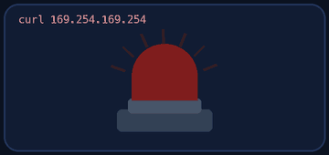
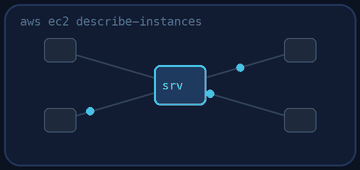
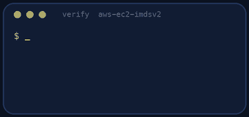
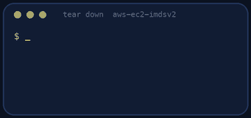

<p align="center"></p>

| | |
|-|-|
| **Time** | 75-90 min |
| **Cost** | free tier, a few cents |
| **You need** | An AWS administrator user (the IAM lab), the AWS CLI v2 configured for it, Python 3 and a terminal, and ssh |

## How this lab works

1. **Fork** this repository to your own GitHub account (button at the top right).
2. Clone **your fork** in your Ubuntu environment (WSL on Windows, your OrbStack machine on Mac).
3. Read the lab below (the same text is in [`LAB.md`](LAB.md)) and follow the mission.
4. Answer the questions in [`SUBMISSION.md`](SUBMISSION.md). Where a question asks for output, paste it in a code block. No screenshots needed.
5. Commit and push. Open the **Actions** tab of your fork (click *I understand my workflows, go ahead and enable them* the first time). The **Lab check** shows what is still missing.
6. When the check is green, **submit the URL of your fork** in the course platform.

> [!NOTE]
> The check only looks at your answers and any files the lab asks you to commit. Your instructor reads your work and may ask you to explain any line.

<p align="center"></p>

## 🎬 The situation

<p align="center"></p>

```text
RED TEAM REPORT - finding 1 of 1                          severity: critical
Target    : a Clippy web server, public, with an IAM role attached
Entry     : the app fetches any URL a user gives it
Payload   : http://169.254.169.254/latest/meta-data/iam/security-credentials/
Result    : the server's temporary credentials, copied out in one request
Impact    : used from a laptop elsewhere for hours before anyone noticed
Technique : SSRF to the instance metadata service (IMDS)
```

That address is not on the internet. It is the **instance metadata service**, reachable only from inside the server, and it hands the server's IAM role credentials to anyone who asks from there. The report is real in shape and the target is yours: in Act 1 you **repeat the attack** on a server you own, so you understand it. In Act 2 you write the defence in three layers: **IMDSv2**, a hop limit of 1, and a role with almost no permissions.

> [!IMPORTANT]
> **Your mission**
> - Launch a Clippy server exactly the way it was launched that day (IMDSv1 allowed, a role that is too generous)
> - From inside it, read the role's credentials, then use them from your own laptop
> - Close the hole and prove from inside the server that the same request now fails
> - Tear everything down and prove it

**Time:** 75-90 min | **Cost:** free tier, a few cents | **You need:** an AWS administrator user, the AWS CLI v2 configured for it, Python 3, ssh, curl and a terminal. The lab uses your default VPC.

<p align="center"></p>

## Part 0 - Launch the vulnerable server

1. **Fork** this repository, clone it, and read `setup.sh` before you run it: it creates a key pair, a role, a security group and the server. Notice the line with `--metadata-options` and the role policy it attaches.
2. Run it and note the address it prints:

```bash
./setup.sh
```

Clippy installs itself in a minute or two (`http://<ip>/healthz`).

> [!NOTE]
> **Think** `setup.sh` opened SSH to *your public IP only* (`/32`). What would have been wrong with `0.0.0.0/0`? What breaks the day your address changes, and how do you fix it without opening the world?

<p align="center"></p>

## Act 1 - Be the attacker

<p align="center"></p>

SSH into the server:

```bash
ssh -i clippy-imds.pem -o IdentitiesOnly=yes ubuntu@<ip>
```

From **inside** the server, ask the metadata service who you are. First the old way (IMDSv1: a plain GET):

```bash
curl -s http://169.254.169.254/latest/meta-data/iam/security-credentials/
curl -s http://169.254.169.254/latest/meta-data/iam/security-credentials/clippy-imds-role
```

You get `AccessKeyId`, `SecretAccessKey`, `Token` and an `Expiration`. Copy them **out of the server** and use them from your own laptop, in a shell where you export the three variables `AWS_ACCESS_KEY_ID`, `AWS_SECRET_ACCESS_KEY` and `AWS_SESSION_TOKEN`:

```bash
aws sts get-caller-identity
aws s3 ls
```

You are now "the server", from anywhere in the world, until the credentials expire. Unset the variables.

> [!NOTE]
> **Think** What could the attacker do with the role as it was created (`AmazonS3ReadOnlyAccess`)? What if the developers had given the role `AdministratorAccess` "to make it work"?

<p align="center"></p>

## Act 2 - Close the hole (three layers)

1. **Require IMDSv2** and set the **hop limit to 1**:

```bash
aws ec2 modify-instance-metadata-options --instance-id <id> \
  --http-tokens required --http-put-response-hop-limit 1 --http-endpoint enabled
```

IMDSv2 needs two requests: a `PUT` that returns a short-lived token, then the `GET` with that token in a header. A simple SSRF bug that can only make a `GET` cannot do the first step. The hop limit stops a container or a proxy one network hop away from reaching the service at all.

2. **Take away what the role does not need.** Clippy needs no S3 access at all in this lab: detach `AmazonS3ReadOnlyAccess` from the role (console or CLI). If it needed one bucket you would write an inline policy for that bucket only.

3. Prove it from inside the server:

```bash
curl -s -o /dev/null -w '%{http_code}\n' http://169.254.169.254/latest/meta-data/iam/security-credentials/     # 401
TOKEN=$(curl -s -X PUT http://169.254.169.254/latest/api/token -H "X-aws-ec2-metadata-token-ttl-seconds: 60")
curl -s -H "X-aws-ec2-metadata-token: $TOKEN" http://169.254.169.254/latest/meta-data/iam/security-credentials/     # works
```

> [!NOTE]
> **Think** Why do the AWS SDKs and the CLI keep working on the same server? (They do the `PUT` for you.) What would break if you had set the hop limit to 1 on a server that runs your app in Docker containers? When would you set it to 2 on purpose?

<p align="center"></p>

## Part 3 - Prove it

<p align="center"></p>

```bash
./verify.sh
```

It reads the real server (metadata options, role, security group) and, over SSH, **attacks it**: IMDSv1 must be refused with 401 and IMDSv2 must still work. Fix what is red and run it again until it ends with **ALL CHECKS PASSED**.

> [!TIP]
> **Stuck?** `Connection timed out` on SSH: your public IP changed; fix the security group rule (`aws ec2 authorize-security-group-ingress` with your new `/32`, then revoke the old one). The 401 never appears: the change takes a few seconds; wait and retry. Clippy does not answer: user data takes a minute or two on first boot.

<p align="center"></p>

## Level up (optional)

- Make **IMDSv2 required by default** for every new instance in the region (`aws ec2 modify-instance-metadata-defaults`) and for new launch templates.
- Write an AWS Config rule or a small script that lists every instance in your account that still allows IMDSv1. How many do you find?
- Use an **instance profile with a narrow inline policy** for one bucket and show that the stolen credentials can then only touch that bucket.

<!-- teardown:start (generated by labs.py, do not edit) -->
## Tear down (mandatory)

<p align="center"></p>

Resources left behind cost money, keep doors open and pollute the next lab. Removing what you created is part of the job, so it is part of the submission: **you must prove it is gone**.

Do this **last**, after you have pasted your `verify` output into `SUBMISSION.md` (once you tear down, the lab can no longer be verified).

1. Run `./teardown.sh`. It terminates the server and deletes the security group, the key pair and the role. Then run `./verify-teardown.sh`.

Then run the proof:

```bash
./verify-teardown.sh
```

It prints a list of checks and must end with **TEARDOWN VERIFIED**. If it reports leftovers, remove them and run it again. Paste the full output in your submission.
<!-- teardown:end -->

<!-- submission:start (generated by labs.py, do not edit) -->
## 📬 Submission

Answer the questions in `SUBMISSION.md` in **your fork** (paste output in code blocks where asked), push, then submit the **URL of your fork**.

**Files to commit**

- `notes.md` with your commands and what you saw (optional)

**Questions to answer**

1. Paste the command and the (redacted) output that fetched the role credentials from `169.254.169.254` with IMDSv1. Which three values did you get and what could you do with them from your laptop?
2. Paste the `aws ec2 modify-instance-metadata-options` you used and the failed request afterwards. What is different about an IMDSv2 request, and why does a simple SSRF bug usually fail against it?
3. What does `HttpPutResponseHopLimit 1` change for a container running on the instance? Where would you set 2 on purpose?
4. Show the role's permission policy. What could an attacker do with the stolen credentials before you fixed it and after?
5. The security group allowed SSH from your IP only. Why is that better than `0.0.0.0/0`, and what do you do when your IP changes?
6. Paste the output of `./verify.sh`. It must end with **ALL CHECKS PASSED**.
7. **Tear down.** Paste the output of `./verify-teardown.sh`. It must end with **TEARDOWN VERIFIED**.
<!-- submission:end -->
